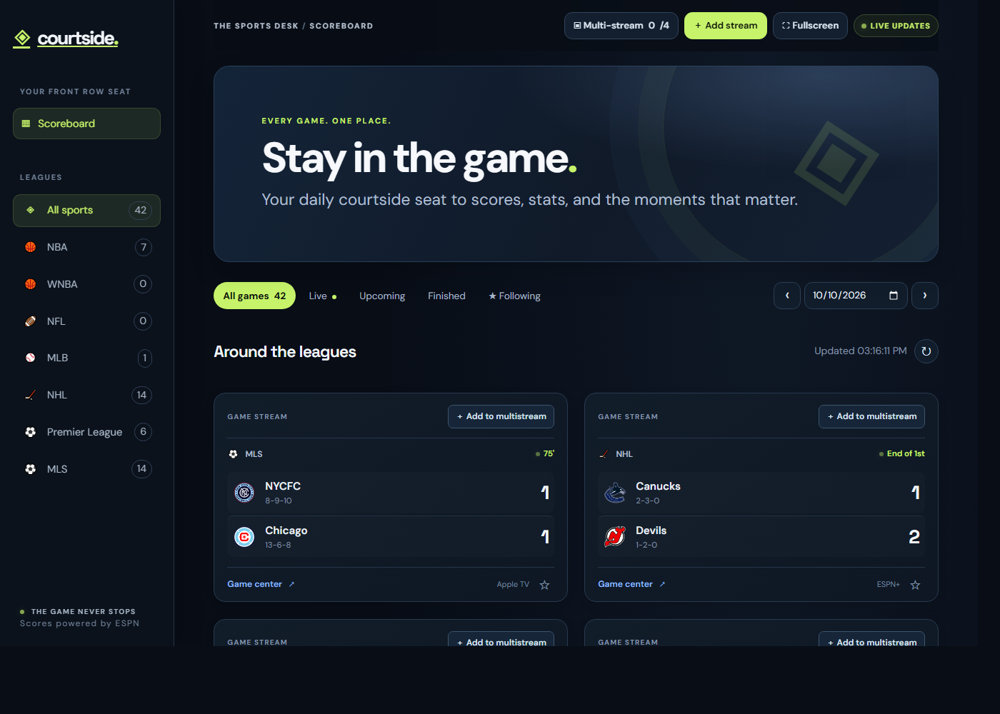

# Courtside Scores

A live sports scoreboard and multi-stream hub. "Your front row seat."

Aggregates live, upcoming, and finished games across NBA, WNBA, NFL, MLB, NHL,
Premier League, and MLS, with scores, game clocks, team records, and streaming
sources. Add up to four games to a multi-stream view with per-tile backup sources
and auto-fallback.

Scores are powered by ESPN.

## Live site

<https://austinmc32.github.io/courtside-scores/>

Hosted on GitHub Pages from the `docs/` folder of `main`. The page is static: it
calls the ESPN and streamed.pk feeds directly, because both send permissive CORS
headers. Regenerate `docs/` after editing anything in `public/`:

```bash
node build-static.mjs
```

## Running it

```bash
node server.js
```

Then open <http://localhost:3001/>. Binds `0.0.0.0` by default; set `PORT` / `HOST`
via env. **Note:** this app runs on port 3001 (not the default 3000) to avoid a
clash with Roku Control.

This is the server variant, which proxies the feeds. `worker.js` + `wrangler.toml`
is the same thing as a Cloudflare Worker. The Pages build needs neither.

## Layout

```
build-static.mjs   generates docs/ (the server-less GitHub Pages build)
docs/              the deployed static build (generated; do not edit by hand)
server.js          HTTP server, ESPN feed proxy, static + gzip serving
app.js             frontend: scoreboard, multi-stream tiles, backup fallback
scoreboard-view.js rendering helpers (score cards, escape, time formatting)
worker.js          background feed worker
public/            static assets
*.test.js          node --test suites (server + UI)
```

## Features

- Live / upcoming / finished / following filters and date navigation.
- Per-league live game counts in the sidebar.
- Multi-stream (up to 4 tiles) with backup stream selection, auto-fallback on a
  failed player, and fullscreen.
- Favorite (star) games and per-game streaming-source links.

## Tests

```bash
node --test            # all suites
node --test server.test.js
node --test ui.test.js
```

## Screenshot



## Change log

- 2026-10-06 - Initial build: live scoreboard aggregating multiple leagues from ESPN.
- 2026-10-07 - Multi-stream view (up to 4 tiles) with backup sources and auto-fallback;
  gzip + ETag static serving; test suites added.
- 2026-10-08 - Background feed worker (`worker.js`) for live updates.
- 2026-10-10 - Port changed to 3001 (via `PORT=3001`) to avoid clashing with Roku
  Control; added README, screenshot, and this change log.
- 2026-10-11 - Deployed to GitHub Pages from `docs/`, generated by `build-static.mjs`;
  the static build calls the feeds directly since both are CORS-open.
